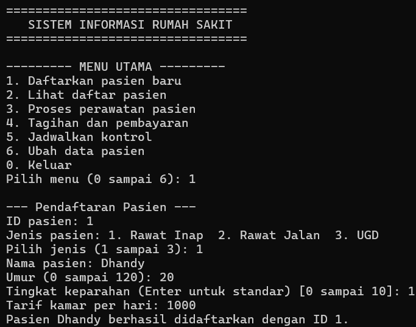
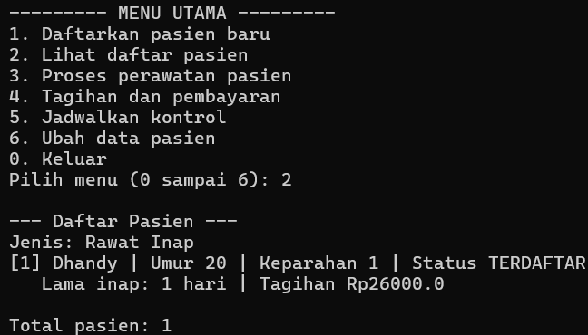
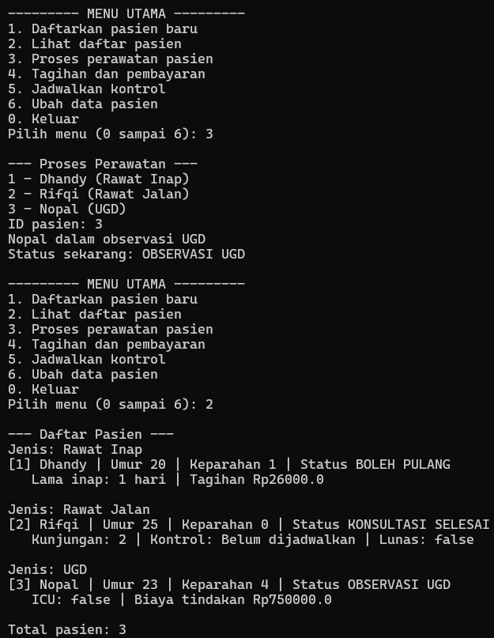
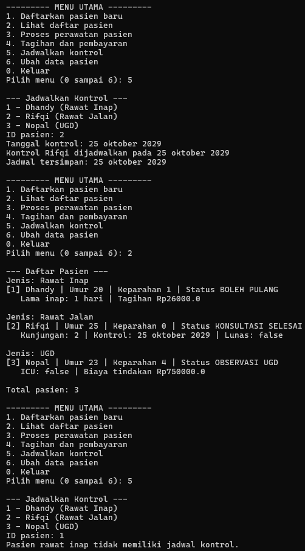
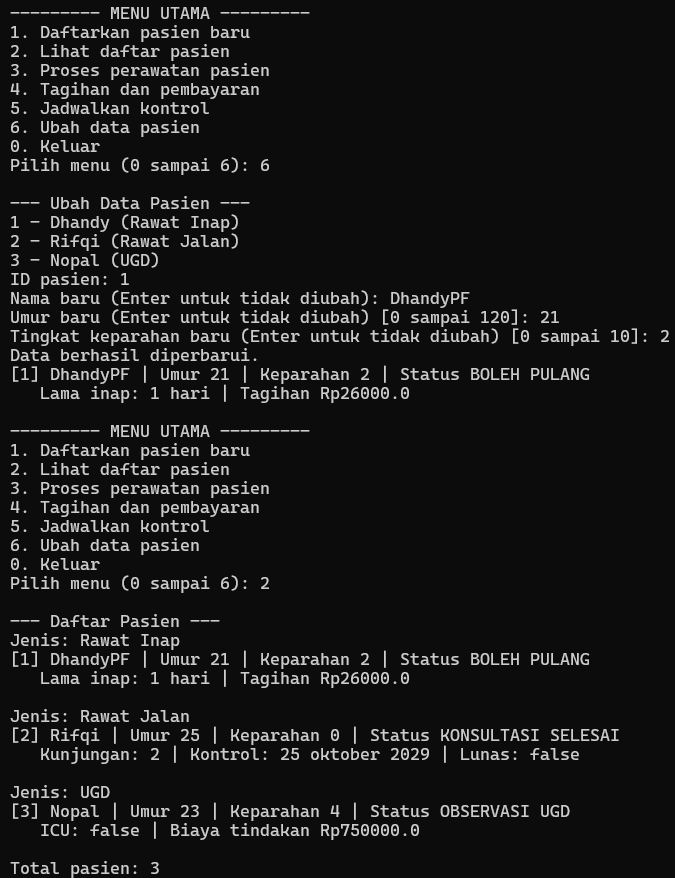
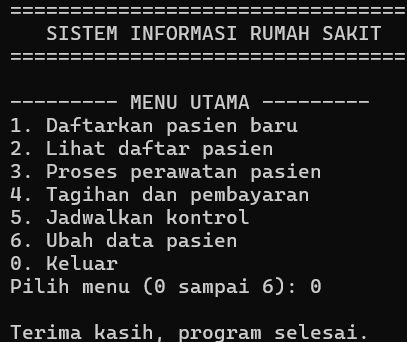

# Responsi Akhir Praktikum PBO

## Identitas
- Nama: Dhandy Putra Fahruddin
- NIM: H1D025097
- Tema: Rumah Sakit

## Compile dan Run
```
cd ./src
javac *.java
java Main.java
```

## Screenshot
### 1. Pendaftaran Pasien Baru


### 2. Melihat Daftar Pasien


### 3. Proses Perawatan Pasien


### 4. Tagihan dan Pembayaran


### 5. Penjadwalan Kontrol


### 6. Ubah Data Pasien


### 7. Keluar Program

